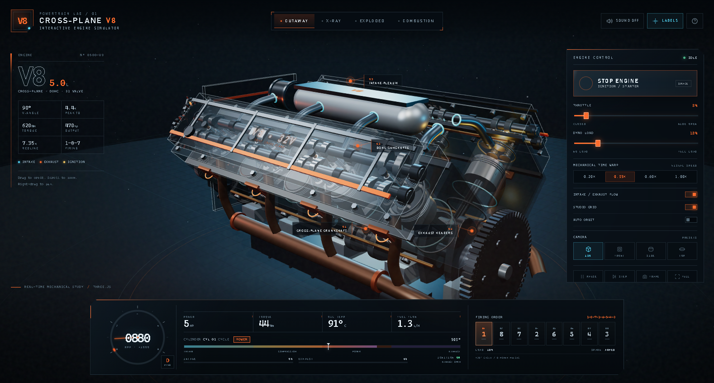

# V8 Engine Simulator / 交互式 V8 引擎模拟器

一个可直接运行的高完成度 Three.js 机械可视化项目：90° 夹角、十字曲轴（cross-plane）5.0L V8，32 气门 DOHC，包含完整的 720° 四冲程循环、1-8-7-2-6-5-4-3 点火顺序、活塞—连杆—曲轴运动学、进排气门升程、双凸轮轴半速驱动、点火与燃烧发光、进排气流粒子、程序化 V8 音频，以及一整套工程仪表 HUD。

**在线演示：[https://engine.xuvps.net](https://engine.xuvps.net)**



## 快速运行

最简单的方式：**直接双击 `index.html`**。

`app.js` 是已经打包好的传统脚本（IIFE），不是 ES Module，因此 `file://` 本地打开也可以运行；Three.js、材质、纹理和音频全部内置于工程中，不依赖 CDN 或网络。

推荐使用本地服务器（便于开发调试）：

```bash
npm install
npm run dev
# 打开 http://127.0.0.1:5173
```

本地服务器启动脚本使用 Node 原生 `http`，没有额外运行时依赖。

## 操作

| 操作 | 功能 |
| --- | --- |
| 鼠标左键拖动 | 环绕观察 |
| 滚轮 / 双指 | 缩放 |
| 鼠标右键拖动 | 平移 |
| `Space` | 启动 / 关闭发动机 |
| `P` | 暂停 / 恢复机械演示 |
| `L` | 显示 / 隐藏 3D 标注 |
| `M` | 开启 / 关闭程序化引擎声 |
| `R` | 回到 ISO 视角 |
| `1`–`4` | Cutaway / X-Ray / Exploded / Combustion |
| 方向键右（暂停时） | 曲轴步进 +90° |
| `H` 或 `?` | 打开操作手册 |

右侧控制面板：

- **START / STOP**：起动机拖动 → 点火 → 怠速；关闭后转速自然回落。
- **THROTTLE**：0–100% 油门，控制目标转速。
- **DYNO LOAD**：测功机负载，负载越高可达转速越低。
- **MECHANICAL TIME WARP**：仅放慢机械视觉速度，仪表仍显示真实 RPM。默认 `0.35×` 便于观察气门和曲轴。
- **INTAKE / EXHAUST FLOW**：进气流（青色）与排气流（橙色）粒子。
- **CAMERA**：ISO、FRONT、SIDE、TOP 四个可重复的工程视角。
- **FRAME**：导出当前 WebGL 画面为 PNG。
- 点火顺序数字 1–8 可点击，切换下方 720° 循环所观察的气缸。

## 可视化模式

- **CUTAWAY**：半透明缸体、缸盖与正时盖，内部曲轴、活塞、连杆、气门和凸轮轴保持完整可见。
- **X-RAY**：更低的铸造件不透明度与更亮的线框，强调内部结构。
- **EXPLODED**：缸盖总成、进气歧管、排气歧管和正时盖沿装配方向展开。
- **COMBUSTION**：强化燃烧闪光、点火高光与排气热色。

## 技术实现

- **纯 Three.js 几何体**：曲轴、曲柄臂、活塞、I 型连杆、气门、弹簧、凸轮、正时链、缸体、歧管、飞轮等全部程序化生成，无外部模型。
- **运动学**：每个气缸使用滑块—曲柄方程  
  `s = r·cos θ + √(L² − r²·sin² θ)`，曲轴销相位由十字曲轴的 90° 曲拐布置推导。
- **四冲程相位**：每个气缸拥有独立 720° 相位偏移，点火事件严格按 `1-8-7-2-6-5-4-3` 每 90° 曲轴角触发。
- **配气机构**：进/排气门升程由 720° 循环中的开启窗口和正弦升程曲线驱动；4 条凸轮轴以曲轴 1/2 速度旋转，凸轮桃尖相位与各缸配气正时对应。
- **燃烧表现**：点火瞬间的 HDR Sprite 闪烁、叠加式核心光球、局部点光源和排气热色，强度随油门与循环角度变化。
- **程序化音频**：根据 V8 点火频率 `rpm / 15 Hz` 生成锯齿波谐波、滤波噪声和软削波，不加载任何音频文件；受浏览器自动播放限制，需要用户点击 SOUND 才会创建 AudioContext。
- **性能**：静态几何按材质合并绘制调用（约 800 → 约 400 draw calls），实例化齿轮齿与链条链节，移动端自动降低 DPR 与阴影分辨率。
- **零外部资源**：所有字体使用系统字体栈，所有贴图（辉光、数字、Logo）由 Canvas 动态生成。

## 目录结构

```
.
├─ index.html          # 入口，可直接双击
├─ styles.css          # HUD / 响应式界面
├─ app.js              # 已打包的运行脚本（构建产物）
├─ src/
│  ├─ main.js          # 场景、灯光、交互、仿真与主循环
│  ├─ engine.js        # V8 几何、运动学、点火与配气
│  ├─ materials.js     # 材质库与观察模式
│  ├─ optimize.js      # 静态几何绘制调用合并
│  ├─ audio.js         # 程序化 V8 声音
│  ├─ ui.js            # HUD、仪表、标注与控件
│  └─ utils.js         # 工具与程序化贴图
├─ scripts/
│  ├─ build.mjs        # esbuild 打包
│  └─ dev.mjs          # 本地静态服务器
└─ package.json
```

## 重新构建

```bash
npm install
npm run build
```

构建只依赖 `three` 与 `esbuild`，产物为 `app.js`。若只修改 `styles.css` 或 `index.html`，无需重新构建 JS。

## 自定义参数

主要参数位于 `src/engine.js` 顶部：

- `PIN_X`：四个曲拐的纵向位置。
- `PIN_BASE`：四个曲拐的相位角。
- `CRANK_RADIUS` / `ROD_LENGTH` / `BORE`：行程、连杆长度和缸径比例。
- `CYLINDER_META`：气缸编号、所属缸列、曲拐与点火顺序。
- `REDLINE` / `IDLE_RPM`：转速边界。

发动机动力曲线与转速响应位于 `src/main.js` 的 `torqueCurve()` 和 `updateSimulation()`。

## 浏览器要求

- 支持 WebGL 2 的现代浏览器（Chrome / Edge / Firefox / Safari）。
- 建议桌面端使用独立显卡或较新的集成显卡。
- 移动端自动启用低功耗设置；控制面板通过右上角 `CONTROLS` 按钮开合。
- 音频需要用户主动开启；页面静音不会影响仿真。

## 备注

这是一个面向展示、教学和交互原型的实时机械模型，不是用于工程标定或 CAE 分析的数值求解器。几何比例、配气正时与燃烧表现以可读性和可视化效果为优先，同时保持正确的 V8 点火顺序与滑块—曲柄运动学关系。
